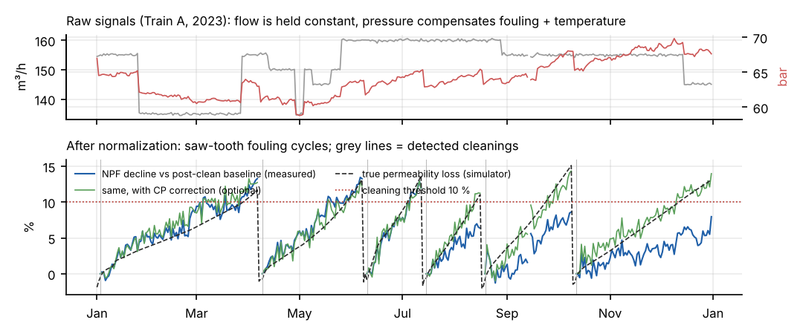

\begin{{center}}{{\large\bfseries Early warning of RO membrane fouling: technical report}}\\[1pt]
{{\small rofoul v1.0.0 · {date} · code, data log and AI-usage log in the repository}}\end{{center}}
\vspace{{-0.2cm}}

**Summary.** The system turns a CSV of RO operating data into normalized performance, a 30-day
fouling forecast and an estimated number of days until cleaning (CIP) is needed. It is delivered
as a Python package, CLI, REST API and Docker image, with a versioned model chosen in a config
file. No suitable public long-term dataset exists, so the method was built and validated on a
physics-based simulator of a 4-train seawater RO plant whose true membrane state is known. In a
purged rolling-origin back-test, quantile gradient boosting cuts days-to-clean error from
**{lin_mae:.1f} to {gbm_mae:.1f} days** (MAE) against a 14-day linear-trend baseline, and 30-day
NPF forecast error from **{lin_h30:.1f} to {gbm_h30:.1f} pp**. It fails when the cause of fouling
is not visible in operating data: algal blooms, pretreatment upsets, sensor drift and an unseen
train.

# 1. Data

Twelve sources were screened (`docs/DATA_SOURCES.md`). Pilot and lab sets (NAWI CCRO, NREL,
Mendeley SWRO) have no long-term fouling or cleaning cycles. The only full-scale public set
(Mendeley MBR–RO) has flows only, so it cannot be normalized. Full-scale studies (e.g. Chebil et
al. 2024) publish figures, not data. As the brief allows, `rofoul synth` simulates 4 trains for 3
years at hourly resolution (about 101k rows). It models solution-diffusion transport under
constant-flux control with a 70 bar pump limit; seasonal temperature (21–34 °C) and salinity;
self-accelerating biofouling that speeds up with temperature and flux; spacer fouling that drives
ΔP; seasonal algal blooms and pretreatment upsets; and operator-triggered cleanings that leave an
irreversible residue, plus membrane ageing. It also injects data defects: noise, spikes, gaps, a
stuck and a drifting transmitter, an antiscalant failure and a membrane replacement. Its physics
deliberately differs from the normalization (TCF constant, osmotic coefficient, concentration
polarization). **Limitation:** the model learns the simulator's fouling law, so performance on a
real plant is unproven until it is retrained on that plant's history.

# 2. Normalization (ASTM D4516-style)

$NPF = Q_p\,\frac{{NDP_{{ref}}}}{{NDP}}\,\frac{{TCF_{{ref}}}}{{TCF}}$, with
$NDP = P_f - \tfrac{{\Delta P}}{{2}} - P_p - (\pi_{{fc}} - \pi_p)$. Here $\pi_{{fc}}$ is the
osmotic pressure of the log-mean feed–concentrate TDS $C_f\ln(\frac{{1}}{{1-R}})/R$ (0.00077
bar per mg/L, scaled by absolute temperature). TCF uses the FilmTec Arrhenius form (U = 2640 /
3020). Normalized ΔP is $\Delta P\,(Q_{{avg,ref}}/Q_{{avg}})^{{1.5}}(\mu_{{25}}/\mu_T)^{{0.3}}$,
with the viscosity exponent taken from the Schock–Miquel spacer friction factor. Salt passage
follows ASTM eq. 2. References are per-train medians of the first 7 days. Data is reduced to
daily medians; days with less than 4 h of data are dropped. Cleaning cycles come from the CIP log
plus confirmed NPF jumps of 4 % or more (without the log, {cip_tp}/{cip_n} cleanings were found
and none were false). Fouling is expressed against each cycle's post-clean baseline (median of
the first 3 full days) as **NPF decline %** and **nDP rise %**.

**Check against the truth.** Raw permeate flow is uncorrelated with true permeability
(r = {corr_raw:.2f}) because the plant holds flow constant; NPF tracks it (r = {corr_npf:.2f}),
with a {norm_mae:.1f} pp error in NPF decline. The main residual is a **temperature artefact**:
NPF reads {artefact:.0f} % lower on hot days than on cold days for the same membrane. In SWRO,
NDP (~15 bar) is a small difference of large pressures (~60 bar feed, ~45 bar osmotic).
Neglecting concentration polarization (CP) biases NDP by a few bar, and that bias matters more as
NDP shrinks in warm water. It hides fouling in autumn and exaggerates it in spring (Fig. 1). The
optional CP correction $\pi_{{fc}}e^{{J/k}}$ (k = 150 L/m²h, a generic value, not the
simulator's) reduces the artefact to {artefact_cp:.0f} % and the error to {norm_mae_cp:.1f} pp.
It is off by default because it needs the membrane area.

\vspace{{-0.15cm}}
{{width=92%}}
\vspace{{-0.45cm}}

# 3. Forecast, threshold and days-to-clean

**Threshold:** clean when NPF has fallen **10 %** or nDP has risen **15 %** from the post-clean
baseline, whichever comes first. These are the manufacturers' criteria (Hydranautics TSB107,
DuPont FilmTec); waiting until losses reach 30–50 % risks fouling that cleaning cannot fully
reverse. **Model:** for each origin day *t* and horizon *h* = 1–30, a direct quantile
gradient-boosting model (scikit-learn, p10/p50/p90, one per indicator and quantile) predicts
$y(t{{+}}h) - \mathrm{{level}}(t)$. Its inputs are causal features only: level, 7- and 14-day
slopes, curvature, days since cleaning, the previous cycle's fouling rate, a $1.08^{{T-25}}$
biofouling factor, temperature trend, TDS, recovery, flux ratio, data completeness, *h* and the
linear extrapolation. The model is monotone in the last two. **Calibration** uses only the last
25 % of each training window: (i) split-conformal widening of the p10–p90 band towards its
nominal 80 % coverage; (ii) a *decision quantile* q\* that makes threshold crossings unbiased. A noisy
indicator crosses a threshold before its median path does (a first-passage effect); in an
early, uncalibrated back-test, predictions were about 8 days late. Days-to-clean is the first crossing of the q\* path; the
widened p90 path and the median path give the earliest and latest estimates. The alert is RED for
7 days or less, AMBER for 14 or less, GREEN otherwise.

# 4. Temporal validation (no leakage)

The back-test uses rolling origins and an expanding window, with three 6-month test folds
({folds}). Each fold's model is trained only on samples whose **label date** precedes the fold
(purged), and is evaluated on every daily origin in the fold. Leakage is excluded because:
features and baselines are causal (a unit test checks that features at *t* do not change when
future data is removed); labels never cross a cleaning; calibration never sees test data; and the
hyper-parameters were fixed beforehand. The baselines are persistence and the **14-day linear
trend** operators typically use. True days-to-clean is the first observed crossing (3-day median),
counted when it happens within 30 days and before a cleaning.

| metric (3 test folds, 4 trains)          | persistence | linear trend | **GBM** |
|:-----------------------------------------------------|:---------------------:|:---------------------:|:-----------------------:|
| NPF decline MAE (pp), h = 7 / 14 / 30 d   | {p_n7:.1f} / {p_n14:.1f} / {p_n30:.1f} | {l_n7:.1f} / {l_n14:.1f} / {l_n30:.1f} | **{g_n7:.1f} / {g_n14:.1f} / {g_n30:.1f}** |
| nDP rise MAE (pp), h = 7 / 14 / 30 d      | {p_d7:.1f} / {p_d14:.1f} / {p_d30:.1f} | {l_d7:.1f} / {l_d14:.1f} / {l_d30:.1f} | **{g_d7:.1f} / {g_d14:.1f} / {g_d30:.1f}** |
| days-to-clean MAE / median / bias (d), n = {n_days} | – | {lin_mae:.1f} / {lin_med:.1f} / {lin_bias:+.1f} | **{gbm_mae:.1f} / {gbm_med:.1f} / {gbm_bias:+.1f}** |
| RED alert (≤ 7 d): precision / recall     | – | {lin_p:.2f} / {lin_r:.2f} | {gbm_p:.2f} / {gbm_r:.2f} |
| p10–p90 coverage NPF / nDP (nominal 0.80) | – | – | {cov_n:.2f} / {cov_d:.2f} |
| unseen train D (not in training): days MAE | – | {hd_lin:.1f} | {hd_gbm:.1f} |

# 5. Where the model fails, and why

**Causes outside the operating data.** When an algal bloom, pretreatment upset or antiscalant
failure starts before the true crossing ({ev_n} of {n_days} origins), days-to-clean MAE rises to
**{ev_gbm:.0f} days** ({ev_bias:+.0f} bias, late), against {noev_gbm:.1f} days otherwise. The
linear trend fails the same way ({ev_lin:.0f} days). The cause is in the feed water, invisible
until fouling has already accelerated; feed-quality inputs (SDI, turbidity, chlorophyll, UF
transmembrane pressure) are needed. **Sensor faults look like fouling.** A 0.5 bar drift of the
concentrate-pressure transmitter raises the nDP error from {dp_norm:.1f} to **{dp_drift:.1f}
pp** and triggers false alarms; slow drift is not filtered. **Unseen asset.** On train D, held
out of training, GBM does not beat the baseline ({hd_gbm:.1f} against {hd_lin:.1f} days): its
fouling kinetics differ, so the model must be retrained per plant. **False alarms traded for
fewer late warnings.** Calibrating for unbiased crossings raises RED recall ({gbm_r:.2f} against
{lin_r:.2f}) but lowers precision ({gbm_p:.2f} against {lin_p:.2f}). q\* should be set from the
plant's real costs (chemicals and downtime against irreversible fouling). **Also:** the
normalization artefact (section 2) shifts measured crossings by days in spring and autumn; there
is no forecast in the first 3 days after a cleaning; a file that starts mid-cycle without a CIP
log underestimates fouling (warned); the p10–p90 band still under-covers ({cov_n:.2f}–{cov_d:.2f}
against 0.80), mostly after events; the model is single-stage.

# 6. Software and reproducibility

`pip install .` or `docker compose up` installs and starts the system. The CLI commands
`rofoul predict | validate | normalize | train | backtest | synth | serve` cover every function;
the REST API exposes `/predict`, `/validate`, `/normalize`, `/model` and `/model/reload`.
Validation returns structured errors (missing columns, unknown or implausible units with a fix
hint, bad timestamps, too many bad rows) and warnings (gaps, duplicates, stuck sensors, spikes),
and reads units from headers. All settings are in YAML. A model is a directory holding
`model.joblib`, metadata, a hash and calibration, selected by `model.path`, so it can be swapped
without code changes; without a model, the system falls back to the baseline. {n_tests} pytest
tests cover normalization physics, leakage, validation, the API and the CLI. Every number here is
regenerated by `rofoul synth / train / backtest` and `scripts/analyze.py`. **Next steps:**
real-plant validation, feed-quality covariates, per-stage normalization, drift detection through
mass and pressure balances, and tuning q\* with operators.
